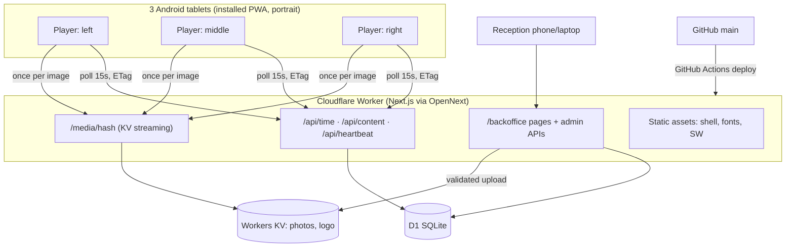
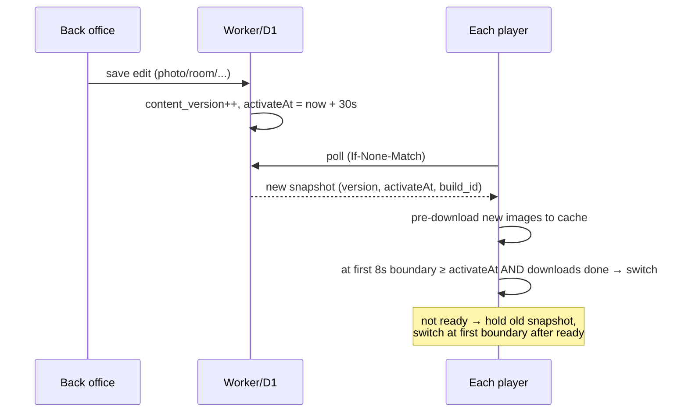
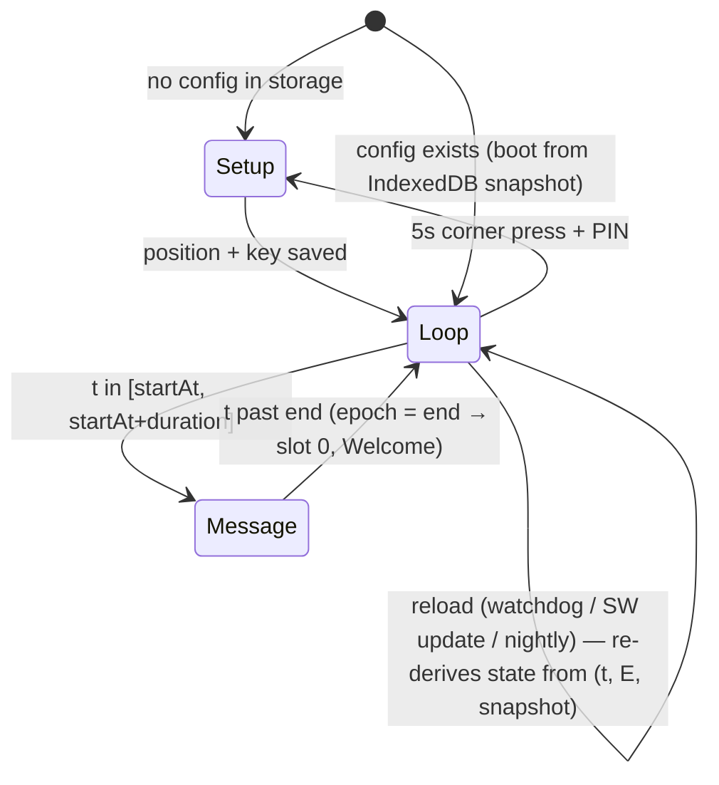

# feat: WestBrook reception wall web app

## Summary

Build the WestBrook hotel reception wall as a single Next.js monolith in this repo, replacing the planned Android APK. Three portrait Android tablets run the player as an installed Chrome PWA, showing a synchronized 8-second photo loop staggered one slide apart per screen. Reception manages content from `/backoffice` behind one shared login. Hosting is Cloudflare Workers (OpenNext adapter) with D1 for data and Workers KV for photos — all free tiers, no payment card anywhere — and every push to `main` auto-deploys via GitHub Actions + wrangler.

## Problem Frame

The behavior spec (`docs/WESTBROOK_ANDROID_APK_BRIEF.md`) and the visual reference (`docs/westbrook-wall-full-loop.html`) fully define the product, but the APK platform was dropped: there is no budget for anything, and a web app the tablets install as a PWA removes the native build, signing, and update pipeline entirely. Where the brief and the reference differ, the reference wins on looks and the brief wins on behavior (`AGENTS.md` rule 0). All behavior, timing, content, and admin rules in the brief still apply; only its platform sections (APK, back-end-as-separate-server) are superseded.

---

## Requirements

**Player behavior**

- R1. The loop plays full-screen photo slides, 8 seconds per slot with a 600 ms cross-fade, in the brief's order: Welcome, rooms, tagged places (Pool terrace, Restaurant, Lobby, Gym, Bar), Reviews, Good to know.
- R2. The three screens are one slide apart (left = slot n, middle = n+1, right = n+2) and change within 0.3 s of each other, driven by server time — never device clocks.
- R3. Persistent overlays per the reference: brand + greeting on the left screen (hidden on its Welcome slide), rotating time card on the right (6 s per city, gold/grey day-night dot, up to 8 cities), nothing on the middle.
- R4. Skipping rules: a room type or tag with no photos, and the Reviews page with no visible reviews, vanish from the loop; the progress bar counts only active slides.
- R5. Captions by tag: rooms show name + naira price + optional tag chip; Restaurant shows name + breakfast line; Pool/Lobby/Gym/Bar show name only.
- R6. The Reviews page advances by exactly one review per loop pass — the same review travels across the wall as the page moves screen to screen — and the rotation must never freeze for any combination of slide count and review count (see KTD on loop math).
- R7. Good to know shows breakfast hours, checkout time, and a Wi-Fi QR built from the escaped `WIFI:T:WPA;S:<name>;P:<password>;;` string.
- R8. Seasonal themes switch by date in the hotel timezone (default Africa/Lagos): Christmas 1 Dec – 6 Jan (handles the year wrap), Independence Day 1 Oct; dates editable in settings.
- R9. Greeting by hotel local time: Good morning 05:00–11:59, Good afternoon 12:00–16:59, Good evening 17:00–04:59; seasonal greetings replace it.
- R10. A message takes over all three screens simultaneously for its duration (default 12 s, 8–30 s), hides overlays, and on end the loop restarts from Welcome via a server-side epoch reset.
- R11. Offline, the player keeps looping from locally cached content and images indefinitely; a reloaded or rebooted player with no network still boots into the loop from cache. The last clock offset is persisted (relative to `Date.now()`), so a device rebooting offline rejoins the loop best-effort on its RTC until the network returns — the one stated exception to R2.
- R12. No blank frames: next two slides preloaded; a slide whose image is unavailable renders its caption card over the themed background.
- R13. Every screen replicates `docs/westbrook-wall-full-loop.html` exactly: its CSS values, fonts (Cormorant Garamond 600, DM Sans 400/500), palettes, and layouts, scaled from the 270×480 design size by one uniform factor `min(screenWidth / 270, screenHeight / 480)`, centered with themed-background letterboxing when the aspect ratio differs. 1080×1920 is the exact-match target; 1200×1920 is the letterboxed case.

**PWA platform**

- R14. The player installs as a fullscreen portrait PWA (manifest `display: fullscreen`, `orientation: portrait-primary`), holds a Screen Wake Lock (re-acquired on visibility/release), and consumes all touch except the hidden setup gesture.
- R15. First run shows a setup screen (position left/middle/right, auto-generated screen key, installer-chosen 4-digit PIN); afterwards the player starts directly. A 5-second press in the top-left corner plus the PIN reopens setup.
- R16. Watchdogs: if no frame is drawn for 30 s the player reloads itself; a nightly reload runs at 04:00 hotel time.
- R17. A new deploy reaches running players without a content flash: the waiting service worker activates and the page reloads at an 8-second boundary, masked by the themed background (manifest `background_color` and body background match the slide background) — at most a brief themed-background gap is acceptable.

**Back office (`/backoffice`)**

- R18. One shared reception password (high-entropy, stored as a Worker secret) behind a rate-limited login issuing a signed session cookie.
- R19. Photos: multi-upload with required room-type or tag, client-side resize to at most 1080×1920 JPEG before upload, 9:16 crop preview, warning for landscape or sub-1080 px sources, delete (soft). Rooms/tags with zero active photos show a "no photos — won't appear in the loop" indicator.
- R20. Rooms: add, edit, reorder, toggle, delete room types (name, price, tag text); Standard, Deluxe, Suite seeded.
- R21. Reviews: first name, month of stay, ~120-char text, required "guest agreed" tick, hide, delete.
- R22. Messages: three seeded editable templates with `{name}` substitution, new templates, post now or schedule, cancel upcoming, overlapping windows rejected, live preview; name required when the template uses `{name}`.
- R23. Settings: hotel name, logo upload (replaces the stand-in "W" everywhere; text fallback), timezone, local city label, cities list, breakfast hours, checkout time, Wi-Fi name/password with live QR preview, restaurant line, season dates and switches.
- R24. A screens status strip: each player heartbeats position + screen key; the back office warns on duplicate positions or a screen silent for over a minute. This is a deliberate addition beyond the brief's five admin sections — the zero-budget substitute for uptime monitoring, and the only way to catch two tablets configured with the same position.

**Infrastructure**

- R25. Everything runs inside Cloudflare free tiers (Workers 100k req/day, D1 500 MB / 100k writes/day, KV 1 GB / 1k writes/day) with no payment card; realistic steady state (~26k req/day including heartbeats and time syncs) stays well under half the request budget, and public endpoints carry per-IP rate limits so abuse cannot burn the hard daily cap.
- R26. Push to `main` auto-builds and deploys via GitHub Actions + wrangler (Cloudflare API token as a repo secret); no other branches exist (`AGENTS.md` rule 1).
- R27. Content edits activate atomically: the server stamps `activateAt = now + 30 s` (covering worst-case 15 s poll staleness plus pre-download time); every player pre-downloads the new snapshot's images and switches at the first 8-second boundary after `activateAt`; a player that isn't ready holds the old snapshot until it is.
- R28. Photos are served through the app from KV under content-hashed immutable URLs, so each tablet downloads each image once.

---

## Key Technical Decisions

- **Stateless render invariant.** At any instant, any player derives exactly what to render from `(serverTime t, loop epoch E, content snapshot, position)` — zero accumulated local state. `slot = floor((t − E) / 8000)`, slide = `active[(slot + position) mod N]` with floored modulo. This one invariant makes reload, sleep/wake, mid-message boot, and late-poll recovery all fall out for free. It gets its own short spec: `docs/SYNC_MODEL.md`.
- **Loop-math corrections to the brief** (implement these, not the literal spec text): floored modulo `((x % N) + N) % N` everywhere and `t < E` clamps to the Welcome slide; review index is `floor((slot + position) / N) mod R` — it advances by exactly one per loop pass and can never freeze (the brief's `slot mod R` freezes whenever R divides N; a per-step variant freezes whenever R divides N+1). Behavior: one review sweeps across the wall per pass, readable as it travels.
- **Design replication by porting, not reinterpretation.** The reference CSS is extracted class-by-class into the player's stylesheet; the player renders a 270×480 layout box scaled with `transform: scale(min(screenWidth / 270, screenHeight / 480))`, centered, letterbox filled with the active theme's background. Fonts are self-hosted woff2 (OFL-licensed, downloaded once) so offline playback keeps typography.
- **Clock sync is hand-rolled NTP-over-fetch.** `GET /api/time` (`Cache-Control: no-store`); client takes 5 samples, keeps the median/lowest-RTT offset, anchors to `performance.now()` (immune to OS clock steps), re-syncs every 5 min. Corrections under ~250 ms slew over a few seconds; larger ones snap at an 8-second boundary. The latest accepted offset is persisted relative to `Date.now()` in IndexedDB; a device booting without network seeds corrected time from it and re-anchors to `performance.now()` after the first successful sync. The once-standard `timesync` library is archived — no dependency.
- **The engine runs on `requestAnimationFrame`, never `setInterval`,** computing slot, phase, and cross-fade opacity from corrected epoch time each frame. The time card city is `floor(t / 6000) mod cityCount`.
- **Messages get a stamped start.** "Post now" becomes `startAt = now + 30 s`; scheduled messages need ≥ 30 s lead; the server rejects overlapping windows; players prefetch the message image and fire locally at `startAt`. A device that slept through a message self-heals because `loop_epoch` rides every poll. Message end is defined as a loop boundary for pending `activateAt` content.
- **Images: resize in the admin browser, write in the Worker.** `createImageBitmap(file, { imageOrientation: "from-image" })` → OffscreenCanvas cover-crop → JPEG q0.85 (≤ 1080×1920); the Worker validates per kind — photos: JPEG magic bytes + ≤ 2 MB; logo: PNG magic bytes or SVG root sniff + 512 KB cap, no resize — and writes to KV under a content-hash key. Workers' 10 ms free-tier CPU limit rules out server-side decoding (confirmed by field reports); Cloudflare Image Resizing is paid. `next/image` optimization is off (`images.unoptimized`).
- **Photos live in Workers KV, served via an app route** (`/media/<hash>.<ext>`, `Cache-Control: public, max-age=31536000, immutable`, per-kind Content-Type; SVG is always rendered via ``, never inlined, so embedded markup stays inert). R2 was the original choice but requires a dashboard enablement that prompts for a payment card (probed 2026-11-18); KV needs neither — 25 MB value cap vs our ≤ 2 MB files, 1 GB free storage vs a ~40 MB hotel deck, and KV's ~60 s edge propagation for new keys is covered by the 30 s activation lead plus the hold-until-ready rule. Deleted photos are soft-deleted and leave via the normal `activateAt` flow; KV objects purge after a 24 h grace.
- **Polling: 15 s with an ETag version short-circuit.** The content endpoint is one idempotent full snapshot (content + settings + `loop_epoch` + `build_id` + active message + `content_version`/`activateAt`), served `Cache-Control: no-store` — edge caching is inert on `*.workers.dev` anyway, and the ETag/304 path is the operative optimization: players send `If-None-Match` and mostly get tiny 304s. It is unauthenticated: everything in it is shown publicly in the lobby — except scheduled messages, which join the snapshot only once `startAt − now ≤ 60 s`, so guest names never leak hours before display. Consecutive admin edits coalesce — latest version wins; intermediates never activate. `/api/content`, `/api/time`, and `/media/*` carry generous per-IP rate limits via the same free binding as login, so abuse can't burn the hard daily cap. Budget: ~26k of 100k req/day.
- **Auth: entropy over KDF.** workerd caps PBKDF2 at 100k iterations and bcrypt/argon2 WASM blows the CPU budget, so the shared password is machine-generated high-entropy (~90+ bits), compared via SHA-256 + `crypto.subtle.timingSafeEqual`, with the free Workers Rate Limiting binding (5/min per IP) on login. Session = HMAC-SHA256-signed cookie (Web Crypto), `HttpOnly; Secure; SameSite=Lax`, 30-day expiry; rotating the secret revokes all sessions. Players don't authenticate reads; the screen key only identifies heartbeats.
- **Offline via Serwist** (`@serwist/next` — `next-pwa` is unmaintained): precache the app shell + fonts, cache-first for immutable `/media/*`, network-first for the content JSON mirrored into IndexedDB, `navigator.storage.persist()` at setup (auto-granted to installed PWAs). SW updates follow R17. This supersedes the brief's §8 APK-update flow.
- **Stack pins:** `next@16` + `@opennextjs/cloudflare@^1.20` + `wrangler@4` + `drizzle-orm` (`/d1` driver) + `drizzle-kit` + `@serwist/next@9`. Empty `defineCloudflareConfig()` (no ISR stack), `compatibility_flags: ["nodejs_compat", "global_fetch_strictly_public"]`, no `runtime = "edge"` exports anywhere (unsupported by the adapter). Migrations via `wrangler d1 migrations` with drizzle-kit generating SQL. U1 verifies `@serwist/next` compiles under Next 16's default bundler with a throwaway build; if Turbopack and the Serwist plugin conflict, the SW compiles via a standalone esbuild step instead (runtime caching strategy unchanged).
- **Deploys: GitHub Actions on push to `main`** — `npx opennextjs-cloudflare build` then `deploy`, authenticated by the Cloudflare API token stored as repo secrets (`CLOUDFLARE_API_TOKEN`, `CLOUDFLARE_ACCOUNT_ID`). Launch URL is `https://<worker>.westbrook-hotel.workers.dev` (subdomain already created via API); a custom domain can attach later at no cost.
- **Back office UX baseline:** fixed bottom tab bar across the six sections (phone-first); up/down buttons as the baseline reorder control; settings grouped into labeled sections (Branding, Time & seasons, Network, Hotel info); screens-status warnings render as a persistent banner across all back-office pages until cleared; forms keyboard-operable with labeled inputs.
- **Boot autostart is the one accepted PWA gap.** In-page watchdogs cover stalls; after a power cut someone taps the icon once. Fully Kiosk Browser's verified-free features (boot autostart, URL launch) are documented as an install-time option — lockdown stays on Android's free Screen Pinning, since Fully Kiosk's kiosk lockdown has historically been a paid PLUS feature. No code changes either way.

---

## High-Level Technical Design

### System topology



### Content activation sequence



### Player mode state machine



---

## Output Structure

```text
app/
  layout.tsx, globals.css          # fonts, base
  manifest.ts                      # PWA manifest
  player/page.tsx                  # the wall player (client)
  backoffice/                      # login + photos/rooms/reviews/messages/settings/screens
  api/                             # time, content, heartbeat, login, admin CRUD, uploads
  media/[key]/route.ts             # KV image streaming
src/
  db/schema.ts                     # drizzle: photos rooms reviews templates messages settings screens meta
  lib/                             # clock-sync, loop-math, season, greeting, wifi-qr, auth, snapshot
  player/                          # slide components, overlays, engine, sw registration
  styles/reference.css             # ported from docs/westbrook-wall-full-loop.html
public/fonts/                      # self-hosted woff2
migrations/                        # wrangler d1 migrations (drizzle-generated)
.github/workflows/deploy.yml       # push-to-main build + deploy
wrangler.jsonc  open-next.config.ts  drizzle.config.ts
docs/SYNC_MODEL.md  docs/RUNBOOK.md  docs/reports/
```

The tree is a scope declaration; per-unit `Files` lists are authoritative.

---

## Implementation Units

Phased per the brief's §11 delivery contract: each phase ends with a plain-language owner report (≤ 15 lines, no code) in `docs/reports/`.

### Phase 0 — pipeline and tablet proof (U1–U2)

### U1. Scaffold, Cloudflare wiring, auto-deploy

- **Goal:** A deployed, installable skeleton: Next.js 16 + OpenNext on Workers, D1 + KV bound, GitHub Actions deploying every push to `main`, PWA manifest installing fullscreen-portrait on a tablet.
- **Requirements:** R25, R26, part of R14.
- **Dependencies:** none.
- **Files:** `package.json`, `next.config.ts` (with `initOpenNextCloudflareForDev()`), `wrangler.jsonc`, `open-next.config.ts`, `.github/workflows/deploy.yml`, `app/layout.tsx`, `app/manifest.ts`, `app/globals.css`, `public/fonts/*`, `.gitignore`, `drizzle.config.ts`.
- **Approach:** `wrangler.jsonc` with `d1_databases` (DB), `kv_namespaces` (MEDIA), `assets`, `services` self-binding, and the rate-limit bindings; empty `defineCloudflareConfig()`; `images.unoptimized`. Create the D1 database and KV namespace with wrangler (API token auth — token at `~/.westbrook-cf-token`, never committed or printed). Add the deploy workflow running the OpenNext build + deploy on push to `main`, with `CLOUDFLARE_API_TOKEN`/`CLOUDFLARE_ACCOUNT_ID` set via `gh secret set`. Verify `@serwist/next` compiles under the default bundler with a throwaway build (fallback: standalone esbuild SW compile). Verify on `*.westbrook-hotel.workers.dev`.
- **Test scenarios:** Test expectation: none — scaffolding; verification is the deployed URL and a successful install ("Install page as app" yields a fullscreen portrait app with no browser chrome).
- **Verification:** push to `main` triggers an Actions run that deploys; the PWA installs and opens fullscreen portrait.

### U2. Sync core and device-proof page

- **Goal:** The timing heart: `/api/time`, client clock-sync, slot math, and a proof page showing a big `floor((t−E)/8000)` counter that flashes and cross-fades at each boundary — the brief's Phase 0 test, run on all three tablets and filmed.
- **Requirements:** R2, groundwork for R1/R27.
- **Dependencies:** U1.
- **Files:** `app/api/time/route.ts`, `src/lib/clock-sync.ts`, `src/lib/loop-math.ts`, `app/player/proof/page.tsx` (temporary route, removed in Phase 3), `docs/SYNC_MODEL.md`, tests `src/lib/__tests__/loop-math.test.ts`, `src/lib/__tests__/clock-sync.test.ts` (vitest).
- **Approach:** per the clock-sync and stateless-invariant KTDs, including the persisted `Date.now()`-relative offset for offline boots. `SYNC_MODEL.md` states the invariant, the poll contract, and the message/epoch rules before any player code exists.
- **Test scenarios:**
  - Happy: offset from 5 synthetic samples picks the median; corrected time within tolerance of injected server clock.
  - Edge: one outlier sample with huge RTT does not skew the offset; `t < E` yields slot 0; floored modulo returns correct slide for negative and wrapping inputs; slot advances exactly at the 8000 ms boundary (no off-by-one at `t − E = 8000`).
  - Edge: review index `floor((slot + position)/N) mod R` advances exactly once per loop pass and cycles through all reviews for N=10/R=5 and N=9/R=5 (the two historical freeze classes).
  - Edge: a simulated reboot with no network seeds corrected time from the persisted `Date.now()`-relative offset.
  - Error: `/api/time` fetch failure retains the previous offset and schedules a retry.
- **Verification:** three tablets filmed side by side flash the same counter within 0.3 s; 2-minute network unplug recovers; `/api/time` responds `no-store`.

### Phase 1 — the player with fake data (U3–U5)

### U3. Reference design port

- **Goal:** The design system extracted verbatim from `docs/westbrook-wall-full-loop.html`: palette variables (night/day/Christmas/Independence), typography, and the scaled 270×480 layout box.
- **Requirements:** R13, R8 (theme palettes).
- **Dependencies:** U1.
- **Files:** `src/styles/reference.css`, `src/player/Screen.tsx` (scale wrapper), font wiring in `app/globals.css`.
- **Approach:** copy the reference's `.screen`, caption, overlay, message, and season classes with their exact values; one `transform: scale(var(--s))` wrapper where `--s = min(screenWidth / 270, screenHeight / 480)`, centered, letterbox filled with the active theme's background. No re-styling, no substitutions (`AGENTS.md` rule 0).
- **Test scenarios:** Test expectation: none — styling; verification is visual.
- **Verification:** side-by-side screenshot comparison of the scale wrapper against the reference file in a browser at 1080×1920 (exact match) and 1200×1920 (letterboxed).

### U4. Slide engine and all loop slide types

- **Goal:** The full loop rendering from a committed sample JSON (same shape as the future API snapshot): Welcome, rooms, places with captions, Reviews, Good to know with Wi-Fi QR; overlays; progress bar; greeting; seasons; skipping rules; 600 ms cross-fades; preloading.
- **Requirements:** R1, R3–R9, R12, R13.
- **Dependencies:** U2, U3.
- **Files:** `app/player/page.tsx`, `src/player/engine.ts`, `src/player/slides/*` (one component per slide type), `src/player/overlays/*`, `src/lib/season.ts`, `src/lib/greeting.ts`, `src/lib/wifi-qr.ts`, `src/player/fixtures/sample-content.json`, tests `src/lib/__tests__/{season,greeting,wifi-qr,active-slides}.test.ts`.
- **Approach:** a pure `buildActiveSlides(snapshot)` derives the ordered active list (skipping rules live here, UI stays dumb); the rAF engine renders `active[(slot + position) mod N]` plus the next two preloaded. QR generated client-side with a small MIT `qrcode` lib. Seasons/greeting are pure functions of hotel-local time.
- **Test scenarios:**
  - Happy: a full sample snapshot yields the brief's 11-step order; captions per tag match R5.
  - Edge (skipping): tag with zero photos absent; zero reviews removes the Reviews page; progress-bar segment count equals active N; empty logo falls back to hotel-name text.
  - Edge (time): greeting at 04:59 is "Good evening", at 05:00 "Good morning"; Christmas active on Jan 3 and inactive on Jan 7 (year wrap); Independence Day only on Oct 1; both-seasons-overlap → single-day season wins.
  - Edge (QR): SSID/password containing `;`, `:`, `,`, `\` escape per the Wi-Fi QR convention.
  - Integration: with position 0/1/2 and the same `(t, E, snapshot)`, the three rendered slides are consecutive.
- **Verification:** every slide type visually matches its reference figure at 1080×1920; the loop runs for an hour in a desktop browser without drift against a stopwatch.

### U5. Message takeover rendering

- **Goal:** Message mode: full-screen takeover (picture and plain variants per the reference), overlays hidden, seasonal tint kept but garland/snow hidden, loop restart from Welcome at message end.
- **Requirements:** R10, R13.
- **Dependencies:** U4.
- **Files:** `src/player/slides/MessageSlide.tsx`, engine additions in `src/player/engine.ts`, fixture messages in `src/player/fixtures/`, tests `src/lib/__tests__/message-window.test.ts`.
- **Approach:** message state is derived, not event-driven: `startAt ≤ t < startAt + duration` → message mode; afterwards the engine uses the post-message epoch. `{name}` substitution shared with the back office preview.
- **Test scenarios:**
  - Happy: during the window all positions render the identical message; at end, slot 0 = Welcome on the left screen.
  - Edge: boot mid-window renders the message at the correct elapsed point; empty name with a `{name}` template never renders a dangling comma (server rejects upstream, player strips defensively).
  - Edge: `activateAt` falling inside a message window activates exactly at message end.
- **Verification:** fixture-driven demo shows takeover and restart matching the reference message figures.

### Phase 2 — back office and real API (U6–U8, U13, U9)

### U6. Schema, snapshot API, and content versioning

- **Goal:** D1 schema + migrations, the public content snapshot endpoint with ETag/304 and `activateAt` semantics, heartbeat endpoint, rate limiting on the public surface, seed data (Standard/Deluxe/Suite, three templates, default settings/cities).
- **Requirements:** R20 (seed), R22 (seed), R25, R27, R24 (heartbeat write).
- **Dependencies:** U1.
- **Files:** `src/db/schema.ts`, `migrations/*`, `src/lib/snapshot.ts`, `app/api/content/route.ts`, `app/api/heartbeat/route.ts`, tests `src/lib/__tests__/snapshot.test.ts`.
- **Approach:** tables `photos rooms reviews templates messages settings screens meta`. Every admin write bumps `meta.content_version` and stamps `activateAt = now + 30 s` (coalescing per KTD). Snapshot is one SELECT-built JSON carrying `build_id` (git SHA injected at build time); scheduled messages are included only once `startAt − now ≤ 60 s`. `ETag: "v{n}"`, `Cache-Control: no-store`. `/api/content`, `/api/time`, and `/media/*` enforce generous per-IP rate limits via the rate-limit binding. Heartbeats at 60 s cadence upsert `screens` (~4k writes/day of the 100k D1 budget).
- **Test scenarios:**
  - Happy: snapshot contains content, settings, epoch, version, activateAt, build_id, active message; matching `If-None-Match` → 304.
  - Edge: two writes 5 s apart yield one final version whose activateAt is the later stamp; soft-deleted photos absent from the snapshot; hidden reviews absent; a message scheduled 10 minutes out is absent until within 60 s of its start.
  - Error: malformed heartbeat ignored without a 5xx; hammering the content endpoint from one IP → 429 while a second IP still gets 200.
- **Verification:** migrations apply clean locally and remotely; the player (U4) runs against `/api/content` instead of fixtures unchanged.

### U7. Shared login, session, and back-office shell

- **Goal:** `/backoffice` gated by the shared password with rate limiting and a signed session cookie, plus the phone-first shell: a fixed bottom tab bar across the six sections.
- **Requirements:** R18.
- **Dependencies:** U1.
- **Files:** `app/backoffice/login/page.tsx`, `app/api/login/route.ts`, `src/lib/auth.ts`, guard layout + tab bar in `app/backoffice/layout.tsx`, rate-limit binding in `wrangler.jsonc`, tests `src/lib/__tests__/auth.test.ts`.
- **Approach:** per the auth KTD (timingSafeEqual compare, HMAC cookie, 30-day expiry, rate-limit binding 5/min/IP). Secrets: `ADMIN_PASSWORD`, `SESSION_SECRET` via `wrangler secret put`. Forms keyboard-operable with labeled inputs (back-office UX baseline KTD).
- **Test scenarios:**
  - Happy: correct password sets a cookie that passes verification; wrong one doesn't.
  - Edge: expired cookie rejected; tampered signature rejected; cookie flags HttpOnly/Secure/SameSite present.
  - Error: 6th attempt in a minute → 429.
- **Verification:** admin routes 302 to login without a valid cookie; player routes stay public; all six sections reachable from the tab bar on a phone viewport.

### U8. Back office: photo pipeline and media serving

- **Goal:** The photos section with the client-side resize upload pipeline, phone-first, plus the `/media` route that serves KV objects.
- **Requirements:** R19, R28.
- **Dependencies:** U6, U7.
- **Files:** `app/backoffice/photos/page.tsx`, `app/api/admin/photos/*`, `src/lib/client-resize.ts`, `app/media/[key]/route.ts`, tests `src/lib/__tests__/client-resize.test.ts` (pure parts) and route tests for upload validation.
- **Approach:** per the image KTDs — browser resize (`imageOrientation: "from-image"`, cover-crop, q0.85); kind-parameterized Worker validation (photos: JPEG magic bytes + ≤ 2 MB; logo: PNG magic bytes or SVG root sniff + 512 KB, no resize); write to KV under a content-hash key; `/media/[key]` streams back with immutable caching and per-kind Content-Type. Multi-upload with required tag/room-type per photo, 9:16 crop preview. Rooms/tags with zero active photos show the "no photos — won't appear in the loop" badge driven by `buildActiveSlides`.
- **Test scenarios:**
  - Happy: upload stores the KV object and creates a photo row with its tag; delete soft-deletes (row flagged, object kept for the 24 h grace).
  - Edge: landscape source triggers the warning but can proceed cropped; sub-1080 px warns; upload without a tag rejected; EXE-renamed-to-JPG rejected by magic bytes; `/media` of a missing key → 404, of a soft-deleted photo within grace → still serves; a room with zero photos shows the won't-appear badge.
  - Integration: a saved upload appears in the next `/api/content` snapshot with a bumped version and future activateAt.
- **Verification:** from a phone: upload a photo → all three screens show it at the same boundary ~30–45 s later (brief Phase 2 check).

### U13. Back office: rooms, reviews, settings

- **Goal:** The remaining content sections: rooms CRUD with reorder, reviews with the consent tick, and settings with live Wi-Fi QR preview and logo upload.
- **Requirements:** R20, R21, R23.
- **Dependencies:** U6, U7, U8 (logo upload reuses the media pipeline).
- **Files:** `app/backoffice/{rooms,reviews,settings}/page.tsx` + their `app/api/admin/*` route handlers, tests for settings round-trip and review consent validation.
- **Approach:** rooms reorder = integer sort column with up/down buttons as the baseline control (drag-and-drop stays deferred polish); logo (PNG/SVG) stored in KV via the U8 pipeline, referenced from settings; settings page grouped into labeled sections (Branding, Time & seasons, Network, Hotel info); QR preview reuses `src/lib/wifi-qr.ts` from U4.
- **Test scenarios:**
  - Happy: room add/edit/reorder/toggle/delete persist; settings round-trip including cities list and season dates.
  - Edge: review save without the consent tick rejected; cities list capped at 8; SVG logo accepted; hiding a review removes it from the next snapshot.
  - Integration: toggling a room off removes its slides at the next activation without touching its photos.
- **Verification:** every brief §9 admin capability for these sections works from a phone browser.

### U9. Back office: messages and screens status

- **Goal:** Message composer (template pick, `{name}` substitution, editable body, optional picture, post now/schedule, duration 8–30 s, cancel) with the overlap and lead-time rules, plus the screens status strip.
- **Requirements:** R22, R24, R10 (server side: epoch reset).
- **Dependencies:** U6, U7, U5.
- **Files:** `app/backoffice/messages/page.tsx`, `app/api/admin/messages/*`, screens strip + warning banner in the back office layout, `src/lib/messages.ts`, tests `src/lib/__tests__/messages.test.ts`.
- **Approach:** per the message KTD: post-now → `startAt = now + 30 s`; scheduled lead ≥ 30 s; overlap rejected with the conflicting window named; cancel forbidden within 30 s of start; on message end the server sets `loop_epoch = startAt + duration` (computed, not cron — the snapshot always reports the correct current epoch). Screens warnings (duplicate position, silent > 1 min) render as a persistent banner across all back-office pages until the condition clears.
- **Test scenarios:**
  - Happy: post-now creates a window 30 s out; snapshot carries it; after the window the snapshot's epoch equals its end.
  - Edge: overlapping schedule rejected; cancel at T−20 s rejected, at T−60 s succeeds; `{name}` template without a name rejected; duration clamped to 8–30 s.
  - Integration: status strip shows three screens with positions; duplicating a position shows the banner on every back-office page.
- **Verification:** brief Phase 3 check: a posted message appears on all three screens within 1 s of its stamped start; a scheduled one waits; the loop restarts on Welcome.

### Phase 3 — resilience (U10–U11)

### U10. Service worker and offline playback

- **Goal:** Serwist-based offline: precached shell + fonts, cache-first media, snapshot mirrored to IndexedDB, boundary-timed SW updates, `storage.persist()`.
- **Requirements:** R11, R17, R25 (static assets don't count against request budget).
- **Dependencies:** U4, U6.
- **Files:** `@serwist/next` wiring in `next.config.ts`, `src/player/sw.ts`, `src/player/sw-registration.ts`, IndexedDB mirror in `src/player/engine.ts`, tests `src/lib/__tests__/snapshot-store.test.ts`.
- **Approach:** per the offline KTD. Image pre-download for R27 runs through the SW cache so "downloaded" and "cached" are the same fact. Update flow: poll compares snapshot `build_id` → `registration.update()` → reload on `controllerchange` at a boundary, masked by the themed manifest/body `background_color` so at most a brief themed frame shows.
- **Test scenarios:**
  - Happy: with network cut, a reload boots into the loop from IndexedDB + cache; images render.
  - Edge: partially downloaded new snapshot at activateAt → old snapshot holds (R27); eviction of one image → caption-card fallback (R12) and backoff refetch.
  - Integration: deploy while playing → player swaps within one loop pass with no content flash (a brief themed-background gap at a boundary is acceptable).
- **Verification:** brief Phase 3 check: pulling the network does not interrupt playback; DevTools offline mode across reload keeps the wall alive.

### U11. Kiosk hardening: setup, wake lock, watchdogs

- **Goal:** First-run setup + hidden re-entry, wake-lock manager, stall watchdog, nightly reload, wake/visibility recovery (immediate re-sync + poll + wake-lock re-acquire), full touch consumption.
- **Requirements:** R14, R15, R16.
- **Dependencies:** U4, U10.
- **Files:** `src/player/setup.tsx`, `src/player/wake-lock.ts`, `src/player/watchdog.ts`, gesture handling in `app/player/page.tsx`, tests `src/lib/__tests__/watchdog.test.ts`.
- **Approach:** config in localStorage: position chosen by the installer, screen key auto-generated at first run (short random id, shown read-only on the setup screen, surfaced via heartbeats in the status strip), PIN chosen by the installer; 5 s top-left pointer-down + PIN reopens setup; everything else `preventDefault`ed. Watchdog: rAF stamps `lastFrameAt`; a 15 s interval reloads if stale > 30 s (intervals fire when rAF throttles). Nightly reload 04:00 hotel time.
- **Test scenarios:**
  - Happy: no config → setup; saved config → straight to loop on next launch.
  - Edge: 4 s corner press does nothing; 5 s + wrong PIN stays locked; visibilitychange→visible triggers re-sync, poll, and wake-lock request.
  - Error: stalled rAF (simulated) triggers reload at 30–45 s.
- **Verification:** on a real tablet: screen stays on for 24 h, random taps do nothing, setup reachable only via the gesture, reboot + one tap resumes lockstep.

### Phase 4 — install and trial (U12)

### U12. Runbook, owner docs, and phase-report scaffolding

- **Goal:** Everything a non-technical operator needs: tablet setup (install PWA, screen pinning, charger + "stay awake" developer option, battery-optimization exemption, optional Fully Kiosk free autostart), back office guide, recovery steps ("wall frozen → do this"), plus `docs/reports/` with the Phase 0–4 owner reports as they complete.
- **Requirements:** brief §11 reporting contract; boot-autostart KTD.
- **Dependencies:** U11 (content reflects final behavior).
- **Files:** `docs/RUNBOOK.md`, `docs/reports/phase-{0..4}.md`, `README.md`.
- **Approach:** plain language, ≤ 15 lines per report, no code or logs. The 7-day trial checklist (glitch log template) lives in the runbook, along with current free-tier usage numbers (requests/day, KV storage, Actions minutes) so limit drift is detectable.
- **Test scenarios:** Test expectation: none — documentation.
- **Verification:** a reader can set up a blank tablet start-to-finish from the runbook alone.

---

## Scope Boundaries

**In scope:** everything above — the complete version 1 of the brief on the new platform.

**Deferred to follow-up work**

- Custom domain attachment (free on Cloudflare once the owner supplies a domain; launch is on `westbrook-hotel.workers.dev`).
- R2 media storage swap, only if the owner ever enables R2 in the dashboard (KV is the no-card choice today).
- Fully Kiosk Browser adoption decision — evaluated during Phase 4 install; requires no code change either way.
- Admin UX niceties beyond the brief (drag-and-drop reorder polish, bulk photo tagging).

**Out of scope (brief §12 — unchanged)**

- Video in the loop or in messages; one image/video spanning all three screens; splitting a message across screens; weather; live room availability; multiple admin users; repeating messages; other languages; sound; anything guests can touch.

---

## Risks & Dependencies

- **Free-tier terms drift.** Cloudflare's free limits were verified November 2026 and are generous (steady state ≲ 26% of the tightest limit); tiers change, so the runbook records current usage. Zero-budget rule (`AGENTS.md` rule 2) forbids quiet upgrades.
- **GitHub Actions minutes.** A private repo gets 2,000 free minutes/month (~500 builds at ~4 min); heavy push-to-main iteration could pinch mid-month. Mitigation: batch pushes during development; the repo can be made public (unlimited minutes) if the owner agrees.
- **OpenNext adapter churn.** Cloudflare now positions its own `vinext` as the default Next.js path; OpenNext remains the mature choice today. Pin versions; revisit only if the adapter breaks.
- **Wake-lock longevity.** The API holds while the page is visible, but Android can kill Chrome under pressure. Mitigations are layered (charger + OS "stay awake", flat memory profile with 2–3 reused image elements, watchdogs, nightly reload); the 7-day trial is the real test.
- **KV propagation.** New keys can take up to ~60 s to reach all edge locations; the 30 s activation lead plus the hold-until-ready rule absorbs it, and upload + playback both happen from Lagos (same region). If stale-image holds show up in Phase 2 verification, raise the lead.
- **Admin-browser trust for image bytes.** The server validates magic bytes/size per kind, not pixel dimensions. Accepted for a single-hotel back office; the 9:16 preview makes bad crops visible before they ship.
- **Boot autostart gap** (PWA cannot self-launch after reboot). Accepted with documented manual relaunch; Fully Kiosk's free autostart is the escape hatch, lockdown stays Android Screen Pinning.
- **Single shared password** is a brief-level decision (§9); rotation via secret update is the compensating control.
- **Tablet hardware unknowns** (make, model, Android version) until Phase 0 runs on the real devices — exactly why the brief's device-proof phase survives the replatform.

---

## Operational Notes

- One-time setup is already done or automated: Cloudflare API token on this machine at `~/.westbrook-cf-token` (never committed, never printed), workers.dev subdomain `westbrook-hotel.workers.dev` created via API, D1/KV created by U1 via the token, `ADMIN_PASSWORD`/`SESSION_SECRET` set via `wrangler secret put`, deploy workflow + repo secrets set via `gh`. Everything else is push-to-`main`.
- All work lands directly on `main` (`AGENTS.md` rule 1); the GitHub Actions workflow is the only deploy path.
- Monitoring is the back office screens strip (R24) — no external monitoring service.

---

## Sources & Research

- Behavior spec: `docs/WESTBROOK_ANDROID_APK_BRIEF.md`; visual law: `docs/westbrook-wall-full-loop.html`; standing rules: `AGENTS.md`.
- Framework research (Nov 2026): OpenNext Cloudflare docs (adapter 1.20.x, Next 16, bindings via `getCloudflareContext`), D1 limits/migrations, Drizzle D1 driver, Workers free limits (10 ms CPU, 100k req/day, 100 MB body, 64 MiB worker, free cron), KV free limits (1 GB, 1k writes/day, 100k reads/day).
- Best-practice research (Nov 2026): Workers-side WASM image resize postmortems (rules it out at 10 ms CPU), NTP-over-fetch patterns + archived `timesync`, Serwist as the maintained SW toolchain, installed-PWA storage persistence auto-grant, workerd PBKDF2 100k-iteration cap, Workers Rate Limiting binding GA (free), Workers Cache behavior (hits still count as requests; static assets don't).
- Flow analysis: stateless-invariant framing, loop-math corrections, message lead/overlap/cancel rules, soft-delete grace, SW-update-at-boundary, duplicate-position detection — folded into R6, R22, R27 and the KTDs above.
- Document review (6 personas, 2026-11-18): review-formula freeze fix, public-endpoint rate limiting, empty-room admin indicator, 30 s leads, offset persistence, kind-parameterized uploads, letterbox scaling, scheduled-message privacy gating, snapshot `build_id`, screen-key/PIN provisioning, Serwist bundler verification — all folded in above.
- Account probe (2026-11-18): token verified (Workers/D1/KV edit OK); R2 not enabled on the account (dashboard + payment-card prompt) → media storage pivoted to Workers KV; `westbrook-hotel.workers.dev` subdomain created via API.
